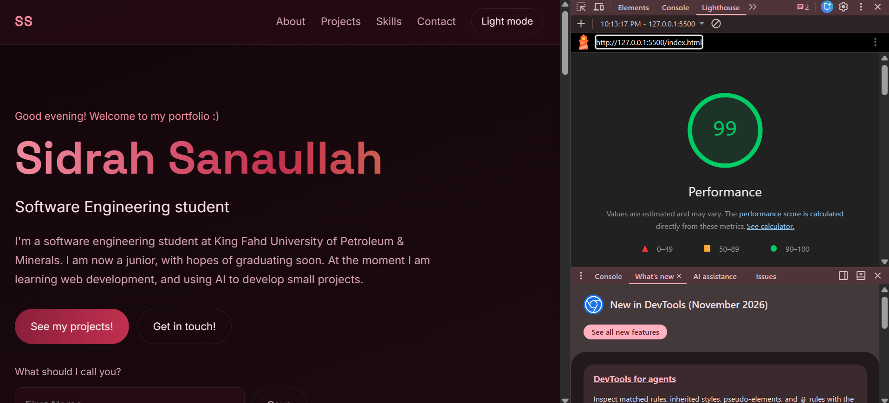

# Technical Documentation

## 1. Project Overview

This project is a simple personal portfolio website created using HTML, CSS, and JavaScript.

The purpose of the website is to introduce myself, show some of the projects I have worked on, list my skills, and provide a way for visitors to contact me.

The website is a static website, so it does not need a backend or database.

In Assignment 3 the website also loads live data from the GitHub API and remembers some visitor settings in the browser.

## 2. Technologies Used

HTML is used to create the structure and content of the website.

CSS is used to style the website and make it responsive.

JavaScript is used to add interactive features.

GitHub Pages can be used to host the website.

The GitHub REST API is used to load my public repositories.

The browser's localStorage is used to remember the theme and the visitor's name.

## 3. File Structure

The project is organized into different folders so the files are easier to manage.

```text
202462320-sidrahsanaullah-assignment3/
│
├── index.html
├── README.md
├── .gitignore
│
├── css/
│   └── styles.css
│
├── js/
│   └── script.js
│
├── assets/
│   └── images/
│
└── docs/
    ├── ai-usage-report.md
    └── technical-documentation.md

## 4. Performance
- Images have width and height set and use lazy loading.
- Lighthouse scores [Performance]: 99

